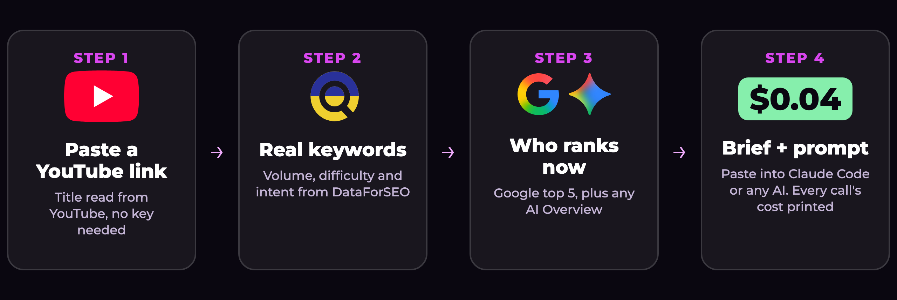

<p align="center"></p>

<p align="center">


</p>

# video-to-blog

Turn one YouTube video into an SEO brief for a blog post: real keywords with search volume and difficulty, who ranks on Google right now, whether Google shows an AI Overview, and a ready-made prompt to write the post. Every run prints exactly what it cost.

It runs on **your own DataForSEO account** (pay as you go, no subscription). Get $5 of credit instead of $1 with this link: https://mrc.fm/dataforseo

## Run it
```bash
export DATAFORSEO_LOGIN=you@example.com        # or DATAFORSEO_USERNAME
export DATAFORSEO_PASSWORD=your-api-password   # dashboard > API Access
node seo-brief.mjs "https://www.youtube.com/watch?v=VIDEO_ID"
```
Node 18+. No dependencies. The brief lands in `briefs/<video-id>.md`. A real example is in [`examples/`](examples/bp_u9Gzp1OU.md): that run cost $0.044.

<p align="center"></p>

Optional second argument: the Google location, e.g. `node seo-brief.mjs "<url>" "United Kingdom"` (default `United States`).

## What it does

<p align="center"></p>

1. Reads the video title from YouTube's public oEmbed (no key needed).
2. Pulls keyword ideas from DataForSEO Labs and scores them: volume you can actually win (low difficulty, informational intent).
3. Checks the live Google top 5 for the best keyword, and whether an AI Overview sits above them.
4. Writes the brief with a prompt you can paste into Claude Code or any AI, plus the cost of every API call.

## Use it with Claude Code
Add the official DataForSEO MCP server and Claude can do the research for you:
```bash
claude mcp add dataforseo -e DATAFORSEO_USERNAME=... -e DATAFORSEO_PASSWORD=... -- npx -y dataforseo-mcp-server
```
Setup guide: https://mrc.fm/dfsmcpguide

Made for the Creator Magic video "Is SEO Dead? I Paid DataForSEO 73¢ to Find Out". Sponsored by DataForSEO.

MIT licence.
